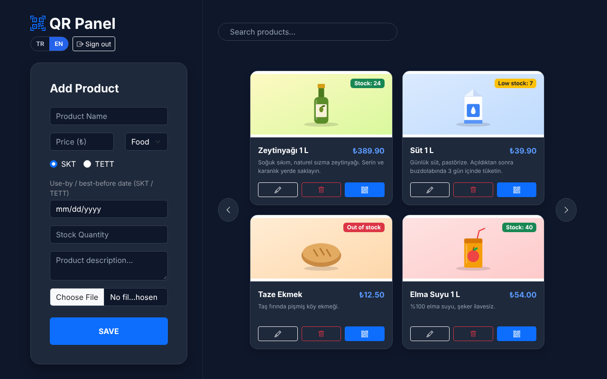
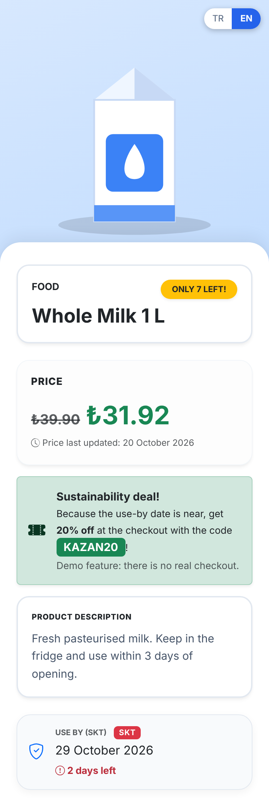
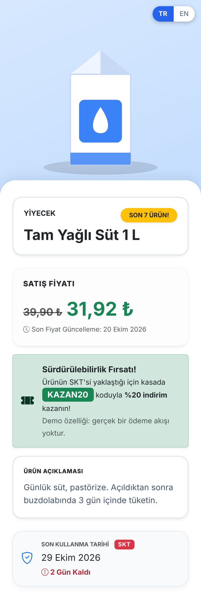
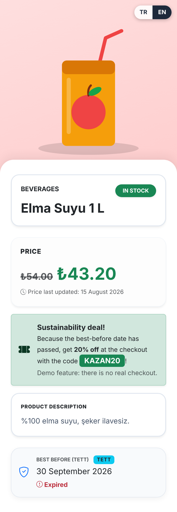
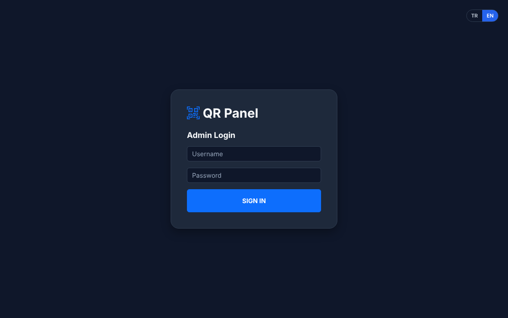
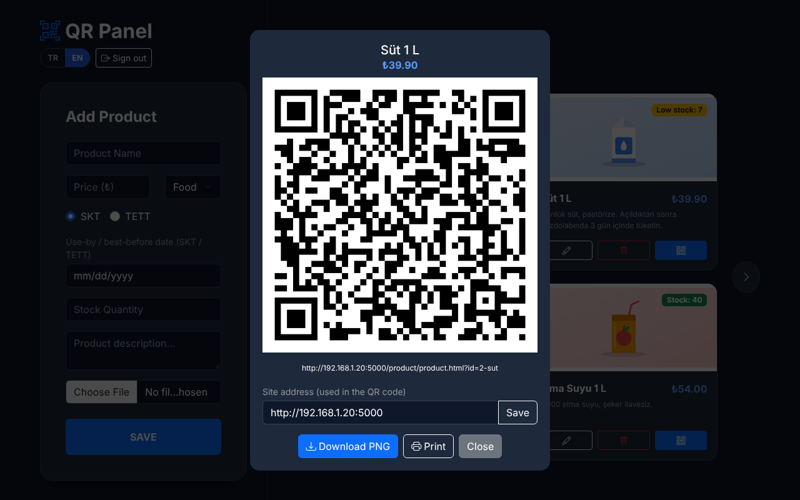
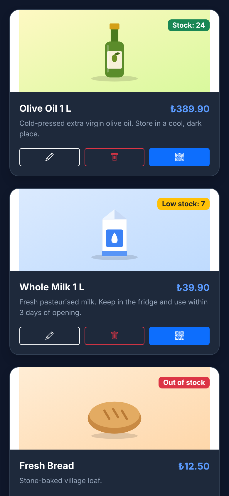
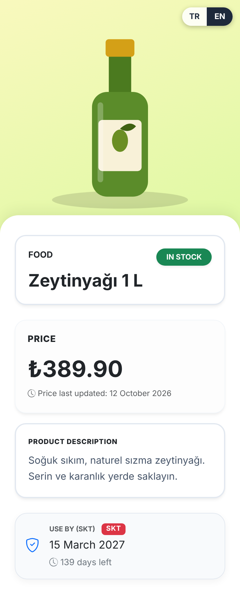

[](https://github.com/Cosmosprey/QrCodeUrunBilgi/actions/workflows/ci.yml)


# QR Product Information System

A QR code based product information system. An administrator manages products in a web panel and prints a QR code for each of them. A customer scans the code with a phone and sees a mobile product page: price, stock, use-by / best-before date and, when the date is close or has passed, a demonstration discount coupon.

It is a small, dependency-light project: **vanilla JavaScript** (plain ES modules, no framework, no build step), **Firebase** as the only backend (Firestore, Storage, Authentication), the interface in **Turkish and English**, and an automated test suite that runs on every pull request.

<p align="center">
  
</p>

<p align="center">
  
  &nbsp;
  
  &nbsp;
  
</p>

> Product names and descriptions are data that a shop enters, so they are shown exactly as entered and are not translated. The screenshots use English example products for the English pages and a Turkish one for the Turkish page.

---

## Contents

- [How it works](#how-it-works)
- [Features](#features)
- [Screenshots](#screenshots)
- [Quick start (no Firebase account needed)](#quick-start-no-firebase-account-needed)
- [Using your own Firebase project](#using-your-own-firebase-project)
- [Tests and code quality](#tests-and-code-quality)
- [Security](#security)
- [Project structure](#project-structure)
- [Technologies](#technologies)
- [Scope and limitations](#scope-and-limitations)
- [AI assistance](#ai-assistance)
- [License](#license)

---

## How it works

```text
Admin creates a product  →  it is stored in Firestore  →  Firestore generates a document ID
        →  the ID is added to the product URL  →  a QR code is generated from that URL
        →  a customer scans the code  →  the product page reads the ID from the URL
        →  the product is loaded from Firestore and displayed
```

The QR code contains only the address `SITE_ADDRESS/product/product.html?id=PRODUCT_ID`, not the product information. A change made in the admin panel (price, stock, date) therefore shows on the customer page immediately, and the printed code never has to be replaced.

There is no custom server. The pages are static files; they talk to Firebase directly, and what each visitor may do is decided by the Firebase security rules (see [Security](#security)):

- **Customer page** (`product/product.html`): anyone may read a single product. It loads only the Firebase app and Firestore code.
- **Admin panel** (`admin/admin.html`): signing in with a username and password (Firebase Authentication) is required; only that one admin account may list, create, change or delete products and upload images.

---

## Features

### Admin panel

- Add, edit and delete products; search by name; paging
- Product image upload. Photos up to 25 MB are accepted and shrunk in the browser before upload (longest side 1200 px, WebP, EXIF rotation applied, transparency kept); small pictures and GIFs are uploaded as they are
- QR code window: shows the product, its price and the code, downloads it as PNG and prints it (only name, price, code and address are printed)
- Shop-wide **site address** setting for the QR codes, stored in Firestore so every device agrees
- Works on phones and tablets (the form moves above the list)
- Feedback: toasts for saved / updated / deleted, a spinner on busy buttons, and "loading", "no products yet" and "no results" messages

### Customer page

- Product image (a neutral icon when it is missing or fails to load), name, category, description, price and the date the price last changed
- Stock status: in stock, critical stock ("only 7 left") or out of stock
- SKT / TETT date with the days left
- Expiry-based discount and coupon (demonstration only)
- Designed for phones; long names and descriptions wrap instead of widening the page

### Stock status

Stock is stored as a number and shown as a status on both pages:

- **More than 10:** in stock
- **1-10:** critical stock
- **0:** out of stock

The limit is `lowStockLimit` in `shared/store-config.js`.

### SKT / TETT

A product stores one of two date types:

- **SKT** - *Son Kullanma Tarihi* (use-by date)
- **TETT** - *Tavsiye Edilen Tüketim Tarihi* (best-before date)

Days are counted as whole calendar days in the visitor's local time, and the date itself is still valid: on the expiry day the page says "last day", and from the next day "expired". The result does not depend on the time of day or the time zone.

When adding a **new** product, an SKT date in the past is rejected (an expired product must not be put on sale). A TETT date in the past is allowed, because the TETT discount is meant for exactly those products. Editing an existing product is never blocked by its date.

### Expiry-based discount (demonstration)

- **SKT:** during the last 3 days, including the expiry day. Expired SKT products get no discount.
- **TETT:** once the recommended date has passed.
- Products without a date get no discount.

The rate (20 %), the 3-day window, the coupon code (`KAZAN20`) and the on/off switch are in `shared/store-config.js`. Prices are rounded to whole kuruş. The coupon is only displayed: there is no checkout, and the page says so.

### Price update date

The date the price last **changed** is stored and shown. Saving other fields (for example the stock) does not change it.

### Languages

The interface is available in **Turkish and English**. A TR / EN switch sits on the login screen, in the admin panel and on the customer page. The first visit follows the browser language (Turkish for Turkish browsers, English for any other) and the choice is remembered in the browser. Prices and dates follow the language (`39,90 ₺` / `₺39.90`). The SKT / TETT terms and the product data stay as they were entered; the stored category names stay Turkish and are only labelled in the current language.

### Accessibility

Every field has a label, icon buttons have names, headings and landmarks are in order, text has at least 4.5:1 contrast, and the QR window is a proper dialog: focus moves into it, Tab stays inside, Escape closes it, and focus returns to the button that opened it. An automated axe-core scan reports no problems on any screen in either language.

### QR site address (local network and phones)

`SITE_ADDRESS` is the address customers reach the pages at. It is set in the QR window ("Site address") and saved in Firestore (`settings/site`, readable and writable only by the admin). Until one is saved, the address the admin page was opened from is used. When that is `localhost` or `127.0.0.1`, the window warns you: a phone cannot reach those addresses, so enter your computer's network address instead (for example `http://192.168.1.20:5000`) and press **Save**. Codes printed earlier keep pointing at their old address; only newly shown codes use the new one.

---

## Screenshots

The images below are generated by `npm run screenshots` (see [Regenerating the screenshots](#regenerating-the-screenshots)).

### Admin panel

| Sign-in | QR window |
| :---: | :---: |
|  |  |

<p align="center">
  
  <br>
  <em>The admin panel on a phone</em>
</p>

### Customer page

<p align="center">
  
  &nbsp;
  
  &nbsp;
  
</p>

---

## Quick start (no Firebase account needed)

The Firebase Emulator Suite stands in for a real Firebase project, so you can try everything locally. You need **Node.js 24.12 or newer** and **Java** (the emulators are Java programs). The web pages themselves need no Node.js at all.

```bash
git clone https://github.com/Cosmosprey/QrCodeUrunBilgi.git
cd QrCodeUrunBilgi
npm install
cp shared/firebase-config.example.js shared/firebase-config.js
```

In `shared/firebase-config.js` set `projectId` to `demo-qr-product-info` and `useEmulator` to `true` (the other values can be any text). Then:

```bash
npm run emulators      # terminal 1: Firestore, Storage, Auth and a web server on http://localhost:5000
npm run seed           # terminal 2: creates the development admin
```

Open <http://localhost:5000/admin/admin.html> and sign in with username `admin` and password `admin123`. Add a product, press its QR button, and open the address shown under the code to see the customer page. Emulator data is kept in memory and is lost when the emulators stop (run `npm run seed` again after a restart).

To scan the code with a phone, put the phone on the same network and enter your computer's network address in the QR window (see [QR site address](#qr-site-address-local-network-and-phones)).

---

## Using your own Firebase project

Firebase configuration is intentionally not included in this repository. Create a Firebase project with **Cloud Firestore**, **Cloud Storage** and **Authentication** (Email/Password provider), then copy the example configuration and fill it in:

```bash
cp shared/firebase-config.example.js shared/firebase-config.js
```

`shared/firebase-config.js` is git-ignored, so your project settings are never committed. Replace the empty values of `firebaseConfig` with the web app settings of your project (Firebase Console → Project settings → Your apps) and leave `useEmulator` at `false`.

The pages are static files: serve the folder with any static web server (the emulator's hosting on port 5000, the Live Server extension of VS Code, `python3 -m http.server`, ...) and open `admin/admin.html`. Customer pages are `product/product.html?id=PRODUCT_ID`.

### Admin account and security rules

Only one admin account may change data. Everyone else can only open a single product page.

1. In the Firebase Console, open **Authentication**, enable the **Email/Password** sign-in method and add a user. The admin panel asks for a *username*; it turns it into an e-mail address of the form `username@qr-admin.local`. So for the username `admin`, create the user `admin@qr-admin.local` with a password of your choice. (Password-reset e-mails therefore do not work; change the password in the console if needed.)
2. Copy that user's **User UID** from the Users table.
3. Replace `dev-admin-uid` with the UID in **both** `firestore.rules` and `storage.rules` (the `isAdmin()` function at the top).
4. Publish the rules: paste each file into the Rules tab of Firestore and Storage in the console, or run `npx firebase deploy --only firestore:rules,storage --project YOUR_PROJECT_ID` (requires `npm install` and `npx firebase login`).

Until step 3 is done, nobody is an admin and every write is denied. This is deliberate: Firebase assigns random UIDs, so nobody can sign up as `dev-admin-uid` on a real project.

### Data model

The application uses a Firestore collection named `products`. Each document has exactly these fields; the rules reject anything else:

| Field | Type | Description |
| :--- | :--- | :--- |
| `name` | string | Product name (2-70 characters) |
| `price` | number | Original price (above 0) |
| `category` | string | Category name (`Yiyecek`, `İçecek` or `Temizlik Malzemeleri` in the admin form) |
| `description` | string | Detailed product info |
| `dateType` | string | `"SKT"` or `"TETT"` |
| `lastUseDate` | string | `YYYY-MM-DD` (may be empty) |
| `image` | string | Image URL starting with `http(s)://` (may be empty) |
| `stockCount` | number | Whole-number inventory count |
| `priceLastUpdate` | string | `YYYY-MM-DD` |

The document ID is generated by Firestore and is used as the product identifier in the QR code URL. The only other document is `settings/site` (the QR site address).

---

## Tests and code quality

```bash
npm test               # unit tests + security rules tests (starts the Firestore and Storage emulators)
npm run test:unit      # only the unit tests; no emulator needed
npm run test:e2e       # browser tests with Playwright (starts the emulators itself)
npm run lint           # ESLint
npm run format:check   # Prettier (npm run format fixes the files)
```

- **Unit tests** (`tests/`, `node:test`): the pure logic (dates in four time zones, stock, discount, prices, QR addresses, image sizes, the translation dictionaries) and the **security rules**, which are tested against the Firestore and Storage emulators: who may read, write and upload what, and which invalid data is rejected.
- **Browser tests** (`e2e/`, [Playwright](https://playwright.dev)): they open the admin panel and the customer page in Chromium and use them like a person would: signing in, adding / editing / deleting products, the QR window and its keyboard behaviour, the discount texts, the language switch, photo shrinking, and an automatic accessibility scan (axe-core) of every screen in both languages. Every test also fails on uncaught page errors and Content Security Policy violations. The first time, install the browser with `npx playwright install chromium`. The tests only ever talk to the emulators: they stop if `shared/firebase-config.js` points at a real project.
- **ESLint** finds mistakes (unused variables, `==`, ...) and enforces the project's security rule: HTML strings are never assigned (`innerHTML`, `insertAdjacentHTML`, ...). **Prettier** formats the JavaScript and the two page stylesheets.
- **[GitHub Actions](.github/workflows/ci.yml)** runs lint, the format check, `npm test` and the browser tests on every pull request and every push to `main`. Dependabot proposes updates of the Actions once a month.

### Regenerating the screenshots

```bash
npm run screenshots
```

starts the emulators, fills them with a few made-up products (their pictures are small drawings made by the script, so no photo rights are involved), fixes the clock to one day and takes the pictures in `docs/screenshots/`. Run it again after changing the interface to keep the README up to date.

---

## Security

- **Access control is enforced by Firebase, not by the pages.** The admin panel requires a login, and the Firestore and Storage rules (`firestore.rules`, `storage.rules`) only let the admin account change data.
- **The rules validate the data**, not only the form: exact field set, types, sizes, date formats and `http(s)` image URLs. Only the admin may upload images; the stored file must be JPEG, PNG, WebP or GIF and at most 2 MB (SVG is rejected on purpose, it can carry scripts). The admin panel shrinks big photos before uploading, so a phone photo of several megabytes becomes a few hundred KB and fits easily.
- **Anyone may read a single product** (that is what the QR code opens), but only the admin may list, create, change or delete products. `settings/site` can be read and written by the admin only.
- **No HTML injection:** the pages never put product data into `innerHTML`; it is always inserted as plain text, and ESLint fails the build if code assigns HTML strings.
- **Content Security Policy:** both pages only allow scripts from their own files and `www.gstatic.com` (the Firebase SDK). There are no inline scripts or inline event handlers, and the libraries (Bootstrap, Bootstrap Icons, the QR library) are included in the repository instead of being loaded from a CDN.
- **Configuration:** Firebase credentials are not in the repository. The Firebase web configuration (API key and project id) is not a secret by itself, because every visitor can see it. What protects the data is the login and the rules, so publish the rules before exposing the project to a network you do not control.

---

## Project structure

```text
admin/        Admin panel. admin_script.js only wires small modules together: auth-ui (login), product-list
              (cards, search, paging, delete), product-form (add / edit), qr-modal (QR window), site-settings
              (the saved site address), product-images and image-convert (upload and shrinking), plus pure helpers
product/      Customer product page
shared/       Code used by both pages: Firebase initialisation, safe DOM helpers, the pure date / stock / discount
              logic (product-logic.js), the store settings (store-config.js), and the language support
              (i18n.js, i18n-core.js and the two dictionaries in locales/)
assets/       Bootstrap, Bootstrap Icons, the QR library (js/vendor/) and one stylesheet per page
tests/        Unit tests and security rules tests (node:test)
e2e/          Browser tests (Playwright)
scripts/      Development helpers: emulator seed, screenshot generator
docs/         The README screenshots
.github/      CI workflow and Dependabot settings
firestore.rules, storage.rules   Security rules
```

---

## Technologies

- HTML5, CSS3 and **vanilla JavaScript** (ES modules); no framework and no build step
- Bootstrap 5.3.8 and Bootstrap Icons 1.13.2 (included in the repository)
- Firebase Firestore, Storage and Authentication (the web SDK is loaded from Google's CDN at a fixed version that a test keeps equal to the development dependency)
- EasyQRCodeJS 4.6.2 (MIT), included under `assets/js/vendor/`, so no CDN is needed for QR codes
- Development only: Firebase emulators, `node:test`, Playwright with axe-core, ESLint, Prettier, GitHub Actions

`package.json` contains development tools only; the project has no runtime dependencies.

---

## Scope and limitations

This is a hobby and portfolio project, meant to be downloaded and run on a local network with your own Firebase project. It is not deployed anywhere.

- It supports a single admin account.
- The discount is a demonstration: there is no checkout, payment or coupon validation.
- The tests and the CI run against the Firebase emulators and in Chromium. The project has not been verified in this repository against a real Firebase project, or in Firefox or Safari.

---

## AI assistance

The first version of this project was written with help from a chat-based AI assistant. Later improvements (security, structure, tests, accessibility, languages, tooling and this documentation) were developed with [Claude Code](https://claude.com/claude-code). Design decisions and code review remain with the project owner.

---

## License

This project is licensed under the Apache 2.0 License - see the [LICENSE](LICENSE) file for details.
